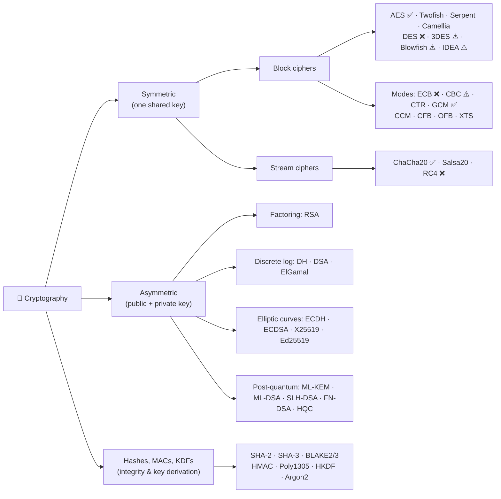

<<<<<<< HEAD
## Security Architecture
- This include the Security Concepts, Designs, and Features

### Diagnostics with the UDS Service 29 “Authentication”
#### ISO14229 
- **ISO14229**: Unified Diagnostic Services (UDS), specifying the application layer requirements for automotive electronic control unit (ECU) diagnostics
- **Client-Server Model:** Operates with an external diagnostic tester as the client and the vehicle ECU as the server
- **OSI Layer Position:** Covers the Application Layer (Layer 7) and works alongside Session Layer (Layer 5) specifications
- **Consolidation:** Merges older legacy diagnostic protocols like KWP2000 (ISO 14230) and Diagnostics on CAN (ISO 15765) into a single manufacturer-independent standard

#### Core Functions & Services
- **Diagnostic Sessions:** Manages operational states (e.g., Default, Programming, and Extended Diagnostic Sessions)
- **Security Access:** Protects sensitive functions (like firmware flashing or calibration) via a seed-and-key authentication challenge
- **Fault Memory (DTCs):** Reads and clears Diagnostic Trouble Codes using services like 0x19 and 0x14
- **Data Read/Write:** Requests real-time sensor values, identification data, and parameter updates via Data Identifiers (DIDs)
- **Routine Control & Flashing:** Starts or stops onboard routines, controls I/O actuators, and handles memory uploads/downloads for firmware updates

#### Key Parts of the ISO 14229 Family
- **ISO 14229-1:** Application layer requirements (updated to Edition 4 in June 2026).
- **ISO 14229-2:** Session layer services and configuration.
- **ISO 14229-3 to -8:** Specialized implementation requirements for CAN (DoCAN), FlexRay, LIN, and Internet Protocol (DoIP)


### Motivation for 0x29
- Formely, diagnostics security was depended on Service 27 “Security Access”
- **Service 27 is breachable and it weakans the ECU**, and the vehicle eventually. But it came to an end, with Service 29 “Authentication”

### Why this replaced Service 0x27
- Service 0x27 - Seed-and-key scheme, usually with one secret algorithm or key shared across a whole ECU family
- Once someone reverse-engineers it from one ECU or one leaked tool, every vehicle with that ECU is open
- It has no notion of who the
  - tester is,
  - no roles,
  - no expiry,
  - no revocation and
  - no session keys
- Service 0x29 fixes each of these
- APCE in particular gives individual identities, scoped rights and revocable trust, and either approach can bootstrap session keys for protecting the traffic that follows

### Choices: APCE Vs ACR
  - APCE suits large tool fleets, aftermarket or independent workshop access, and anywhere you need roles or revocation
  - ACR suits closed environments such as end-of-line production, a single OEM tool, or ECUs too constrained for certificate parsing. Use the asymmetric flavour unless the symmetric keys are diversified per ECU.

### What is the Authentication Service?
- Service 29 in the Unified Diagnostic Services (UDS) protocol, known as “Authentication,” was added in a 2020 update to the standard
- Provides a more modern approach to authentication compared to the Security Access (0x27) service
- Service includes **bidirectional authentication with PKI-based Certificate Exchange**, offering a standardized method for secure communication and access control within automotive electronic systems
- Crucial during
  - Downloading
  - Uploading routines and data
  - Reading from specific memory in a server, where improper handling could harm vehicle components or compromise compliance standards
  - Prevent data security breaches when retrieving data from a server
  - **Service offers two security approaches**
  
 #### Two Security approaches
 - PKI Certificate Exchange
   - Based on **PKI certificate exchange using asymmetric cryptography**, employing
     - **Card Verifiable Certificate (CVC) (ISO 7816–8)** - **Relation to ISO/IEC 7816-8**
       -  Lightweight digital certificate designed specifically to be parsed and verified by resource-constrained devices, such as smart cards and ePassports, which have limited memory and processing power.
       -  Unlike heavy X.509 certificates that use complex ASN.1 parsing and dynamic trees, CVCs use a **straightforward Type–Length–Value (TLV) structure with fixed-length or max-length fields in a strictly defined order**.
       -  Compact Size: Much smaller footprint than standard X.509 certificates
       -  Fast Parsing: Fixed TLV fields allow chips to validate certificates without holding large nested structures in RAM.
     - **X.509 (ISO/IEC 9594–8, RFC 5280, RFC 5755, IEEE 1609.2) formats**.
 - Challenge-response procedure without PKI certificates
   - Utilizes a **challenge-response procedure without PKI certificates**, either through **asymmetric cryptography with software authentication tokens** or **symmetric cryptography**.

#### High-Level Concept - Service 29 security concepts
  

#### Low-Level Concept - Service 29 security concepts - Big picture: why Service 0x29 replaced 0x27
  

### PKI Certificate Exchange
#### Authentication with PKI Certificate Exchange (APCE)
- PKI Challenge-response procedure without PKI certificates
- Several functions for authentication and certificate management
- Ending an authenticated state?
- Unidirectional and bidirectional authentication
- Proof of ownership (POWN) transmission
- Independent certificate transfer
- **Key prerequisites:** Client and server having respective certificates and private keys.
- **Key Response = Proof of Ownership**


The authentication process, depending on unidirectional or bidirectional needs, involves a series of steps including challenge creation, certificate verification, ephemeral key pair generation for session key establishment, and proof of ownership calculation

#### Authentication with Challenge-Response (ACR)
- Asymmetric cryptography with software authentication tokens

##### Bidirectional ACR exchange


####### Symmetric cryptography

### Authentication with PKI Certificate Exchange (APCE) - Unidirectional Mode + Session Keys


### Authentication with PKI Certificate Exchange (APCE) - Bidirectional Mode + Session Keys


### Authentication with Challenge-Response (ACR) - Bidirectional Mode + Aymmetric


### Authentication with Challenge-Response (ACR) - Unidirectional Mode + Symmetric


### Authentication with Challenge-Response (ACR) - Unidirectional Mode + Aymmetric


### UDS_0x29_Variants_Comparison


### What I learned
- UDS Service - 0x27 is Weak and Vulnerable
- UDS Service - 0x29 Authentication Service is more robust
- Types
  - Authentication with PKI Certificate Exchange (APCE) - Unidirectional or Bi-directional mode
    - Asymmetric
    - Types of Certificates
      - CVC ISO 7816-8
      - X.509 (ISO/IEC 9594–8, RFC 5280, RFC 5755, IEEE 1609.2)
  - Authentication with Challenge-Response (ACR) - Unidirectional or Bi-directional mode
    - Asymmetric
    - Symmetric
- Key Response = Proof of Ownership

### Reference
https://medium.com/@mkklyci/implementing-advanced-secure-diagnostics-with-uds-authentication-service-29h-9b1b9ec762ec

### Development Hints
To list down all the commands you have given in the console
```
doskey /history
```

```
git clone https://github.com/NaveenSEC/SecurityArchitecture.git
cd SecurityArchitecture
git add .
git status
git commit -m "Added diagram images"
git push -u origin main
// to be added later
ssh -T git@github.com
git push -u origin main
git pull origin main --allow-unrelated-histories
git push -u origin main
git push -u origin main --force
```

 

  

  
=======
# 🔐 Cryptography Algorithms: A Visual Guide

> How the major symmetric, asymmetric and post-quantum algorithms work, how they differ, and why the strong ones are strong.

**Status legend:** ✅ Recommended  ·  ⚠️ Legacy / use with care  ·  ❌ Broken / do not use

---

## 📑 Contents

| # | Topic | What's inside |
|---|---|---|
| 1 | **Symmetric** | [Block ciphers](docs/01-symmetric/block-ciphers.md) (AES, DES, 3DES, Blowfish, Twofish, IDEA, Serpent, Camellia…) · [Modes of operation](docs/01-symmetric/modes-of-operation.md) (ECB, CBC, CTR, GCM, CCM, XTS…) · [Stream ciphers](docs/01-symmetric/stream-ciphers.md) (RC4, Salsa20, ChaCha20) |
| 2 | **Asymmetric** | [Overview](docs/02-asymmetric/overview.md) · [RSA](docs/02-asymmetric/rsa.md) · [Diffie-Hellman](docs/02-asymmetric/diffie-hellman.md) · [ECC: ECDH, ECDSA, Ed25519](docs/02-asymmetric/ecc.md) · [ElGamal & DSA](docs/02-asymmetric/elgamal-and-dsa.md) |
| 3 | **Post-quantum** | [Overview & LWE](docs/03-post-quantum/overview.md) · [Key encapsulation & ML-KEM](docs/03-post-quantum/ml-kem.md) · [PQ signatures: ML-DSA, SLH-DSA](docs/03-post-quantum/pq-signatures.md) · [Hybrid PQ](docs/03-post-quantum/hybrid.md) |
| 4 | **Supporting primitives** | [Hashes, MACs, KDFs, password hashing](docs/04-supporting-primitives.md) |
| 5 | **TLS** | [TLS 1.2 vs TLS 1.3 handshakes](docs/05-tls.md) |
| 6 | **Comparisons** | [Master comparison tables & what to use today](docs/06-comparisons.md) |

---

## 🗺️ The Big Picture



| | Symmetric | Asymmetric |
|---|---|---|
| **Keys** | One shared secret key | Key pair: public + private |
| **Speed** | ⚡ Very fast (often hardware-accelerated) | 🐢 100–1000× slower |
| **Main problem solved** | Bulk data confidentiality | Key distribution, digital signatures |
| **Main weakness** | How do both sides get the key securely? | Too slow for bulk data |
| **Typical key size for ~128-bit security** | 128 bits | RSA 3072 bits / ECC 256 bits |
| **Examples** | AES, ChaCha20 | RSA, ECDH, Ed25519, ML-KEM |

> 💡 **In practice they are combined (hybrid encryption):** asymmetric crypto agrees on a key, symmetric crypto encrypts the data. That is exactly what TLS, SSH, Signal and PGP do.

---

## ✏️ Editing this guide

- Each topic lives in its own file under [`docs/`](docs/), so edit only the file you need.
- Diagrams are written in [Mermaid](https://mermaid.js.org/). Paste a diagram block into [mermaid.live](https://mermaid.live) to edit it visually, then paste it back.
- On github.com, press <kbd>.</kbd> in the repo to open a VS Code editor in the browser. Locally, VS Code with the *Markdown Preview Mermaid Support* extension shows a live preview.
- Adding an algorithm? Add a section to the matching file (or a new file) and a link in the table above.

*Contributions and corrections welcome. Open an issue or pull request.*
>>>>>>> 7a7f838f88450a7104ed1d4e4b23c98511423e8e
